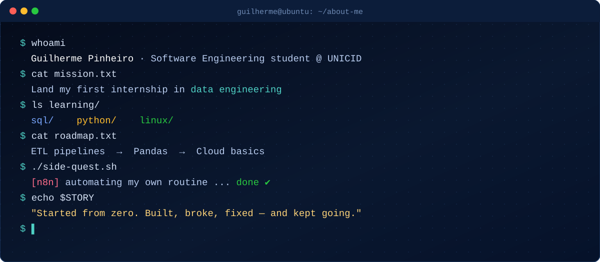

  

  
  
  

---

<h2 align="center">👋 About Me</h2>

  

  
<b>📖 Read my story</b>

   
  I started college as a beginner, so this GitHub is my learning log: every project here is something I built, broke and fixed along the way. I already work at a company, which made me see how much business still runs on spreadsheets, and that's exactly the kind of problem I want to solve with <b>SQL, Python and data pipelines</b>.
    
  Expected graduation: 2029 · São Paulo, Brazil

---

## 💼 Experience

**Industrial company · São Paulo** · *current*
 Day-to-day contact with inventory, tax and bank reconciliation controls that still live in spreadsheets. Exploring how SQL and Python could centralize them.

**ERP Barbearias · UNICID Integrative Project** · *2026, group work*
 Conceptual and logical data modeling (32 tables) and organization of SQL Server scripts for a real partner business.

**T.I.A.O. System · UNICID academic fair** · *2026, team of 16*
 Contributed the hardware components list and budget to the project documentation ([merged pull request](https://github.com/criszst/T.I.A.O-System/pull/4)).

---

## 📂 Featured Projects

<table>
  <tr>
    <td width="50%" valign="top" align="center">
      <h3>💈 ERP Barbearias</h3>
      <i>Estúdio XXI — data modeling</i>
      
Multi-company ERP data model for barbershops, built for a real partner business: ER diagram, SQL scripts and test data.

      <code>SQL Server</code> <code>T-SQL</code>
        
      
    </td>
    <td width="50%" valign="top" align="center">
      <h3>🧮 Scientific Calculator</h3>
      <i>Desktop app</i>
      
Full scientific calculator with a graphical interface, keyboard support and advanced functions.

      <code>Python</code> <code>Tkinter</code>
        
      
    </td>
  </tr>
  <tr>
    <td width="50%" valign="top" align="center">
      <h3>🏧 MiniBank ATM</h3>
      <i>Console application</i>
      
ATM simulator running in the terminal.

      <code>C</code>
        
      
    </td>
    <td width="50%" valign="top" align="center">
      <h3>🤖 T.I.A.O. System</h3>
      <i>Group project · hospital triage robot</i>
      
Arduino + Python robot that simulates hospital pre-triage for an academic fair. My contribution: hardware components list and budget documentation.

      <code>Arduino</code> <code>Python</code>
        
      
    </td>
  </tr>
  <tr>
    <td width="50%" valign="top" align="center">
      <h3>✂️ Barbearia Studio XXI</h3>
      <i>Group project · front-end website</i>
      
Ten-page website for a barbershop: services, booking, team, gallery and contact, with native form validation. Built with semantic HTML and CSS only.

      <code>HTML5</code> <code>CSS3</code> <code>Flexbox</code>
        
      
      
    </td>
    <td width="50%" valign="top" align="center">
      <h3>🧩 Logic Exercises</h3>
      <i>Personal project · interactive web app</i>
      
90 fill-in-the-blank Python logic exercises across three difficulty levels, running in the browser. Built with the support of Claude Code to explore AI-assisted programming.

      <code>JavaScript</code> <code>HTML5</code> <code>CSS3</code>
        
      
      
    </td>
  </tr>
  <tr>
    <td colspan="2" valign="top" align="center">
      <h3>📈 B3 Market Data Pipeline</h3>
      <i>Personal project · financial data</i>
      
Collects Brazilian stock quotes from an API, keeps the raw responses and the price history in SQL, with an audit trail of every run and automated tests.

      <code>Python</code> <code>SQL</code> <code>SQLite</code> <code>API</code>
        
      
    </td>
  </tr>
</table>

---

## 🛠️ Tech & Tools

**Data & Languages**
 

**Web**
 

**Environment & Tools**
 

---

  <picture>
    <source media="(prefers-color-scheme: dark)" srcset="https://raw.githubusercontent.com/gwilhrm/gwilhrm/output/github-contribution-grid-snake-dark.svg">
    <source media="(prefers-color-scheme: light)" srcset="https://raw.githubusercontent.com/gwilhrm/gwilhrm/output/github-contribution-grid-snake.svg">
    
  </picture>

---

  

